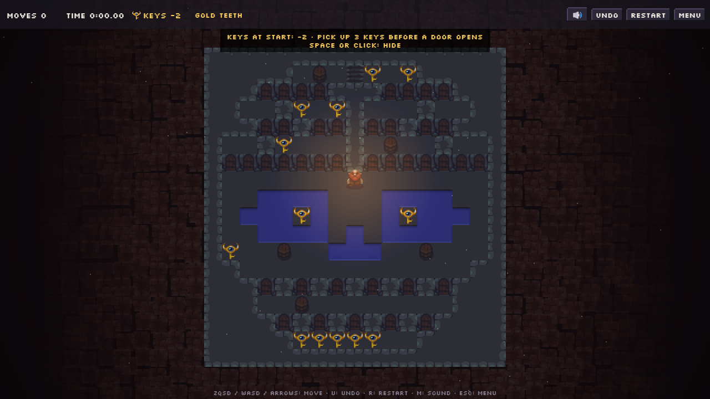
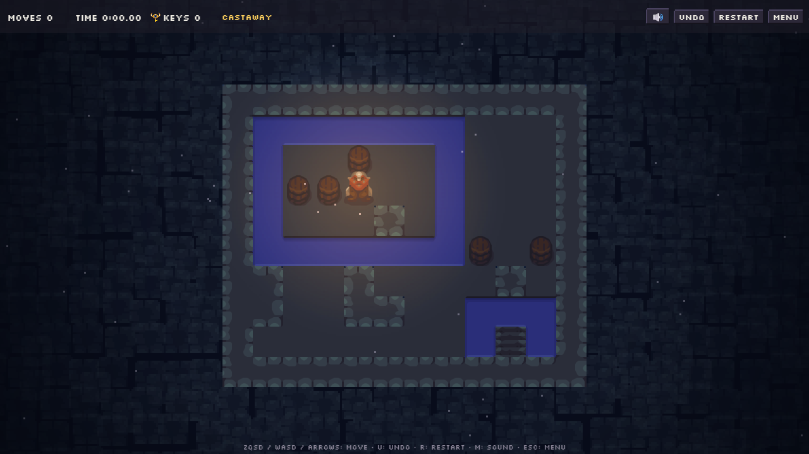
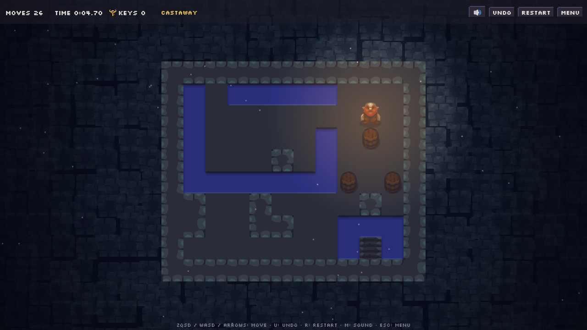
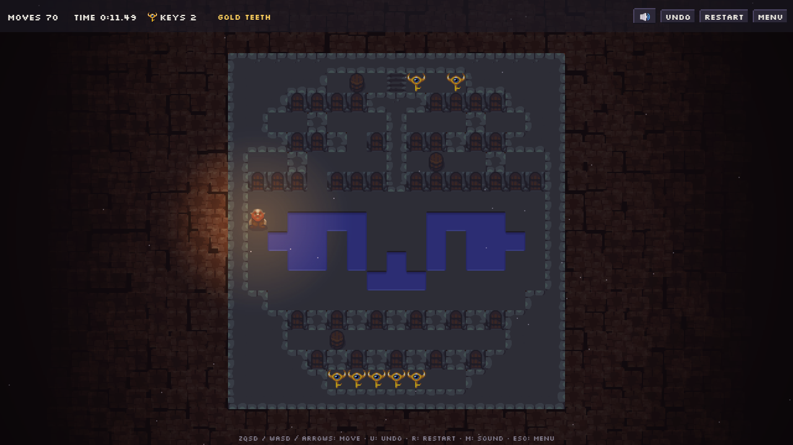
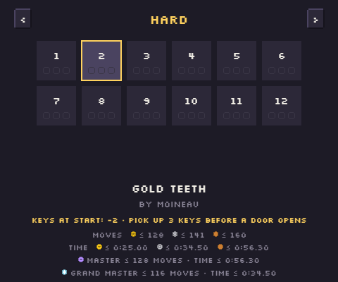
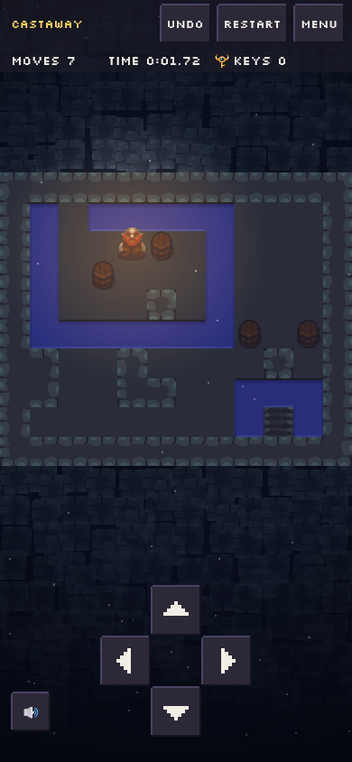

# puzzleCave

A turn-based block-pushing puzzle game for the browser and your phone. Push blocks, fill the water,
collect keys, open doors… and find your way to the exit in as few moves as possible.

**▶ [Play puzzleCave](https://skerdudou.github.io/puzzleCave/)** — free, no account, works offline
once loaded, and can be installed as an app on Android.

  

## How to play

You are trapped in a cave: reach the **exit** to finish the level. There are no enemies and no clock
running out (except in master mode, below) — take your time, every move counts.

- **Blocks** — walk into a block to push it one cell, if the cell behind it is free floor. You cannot
  pull a block, and you can only push one at a time: a block stuck in a corner stays there.
- **Water** — you cannot walk on water, but a block pushed into it sinks and becomes a bridge. Each
  block fills a single water cell, so think before you use one.
- **Gravel** — you can walk on gravel, but blocks cannot be pushed onto it.
- **Keys and doors** — walk over a key to pick it up; walk into a door to open it, which uses one key.
  Some levels give you more doors than keys, or start you in debt: choose which doors to open.
- **Exit** — step onto it to win.

<table>
  <tr>
    <td></td>
    <td></td>
  </tr>
  <tr>
    <td align="center"><b>Castaway</b> — stranded on an island with three barrels…</td>
    <td align="center">…push them into the water to build your way out, and save some for the pond around the exit.</td>
  </tr>
</table>

   
  <b>Gold Teeth</b> starts you two keys in debt: pick up keys to pay it back before a door opens,
  then spend them on the right doors.

Made a mistake? **Undo** as many moves as you like, or **restart** the level (master mode, below,
has no undo).

## Medals

Each level awards a medal for the number of **moves** — gold, silver or bronze (a few levels also
have a medal for the **time** you took). The level selection screen shows the limits for each
medal. Gold means a good, honest solution; you do not need to find the cleverest route to get it:
from the Medium chapter on, the gold limit is always above the best solution (a good alternative
route, or about 10 % more moves than the best one; on the Hard and Expert levels, between 10 % and
25 % more moves than the best known solution).

   
  The selection screen: the limits of each medal for Gold Teeth.

### Master mode: master and grand master

From the **Medium** chapter on, earning gold on a level unlocks its **master mode** (the
**Master** button, or **P** on the selection screen). In master mode:

- **no undo** — and restarting starts a brand-new attempt;
- water no longer stops you… **it drowns you**;
- **against the clock**: on a level with time medals, you must finish within its **bronze time**.
  The clock starts with your first move (study the map as long as you like before it) and the
  remaining time is shown at the top, in red for the last seconds. Past it the attempt fails,
  like drowning: restart for a new one. The clock stops while the game is hidden (another app,
  screen locked); leaving for the menu ends the attempt.

Master mode has two medals of its own:

- **Master** (a violet medal with a crown): finish in master mode within the **gold** move limit;
- **Grand master** (a light-blue medal with a white sparkle): finish in master mode within the
  **grand master** limit, the best solution known — often a different, cleverer route than the
  gold one — and, on a level with time medals, within its **silver time**. Grand master includes
  master: a run within the grand master moves but slower than the silver time earns master.

Master mode is a separate achievement, with its own line on the selection and result screens: the
limits, one line per medal, for example "Master ≤ 610 moves · time ≤ 3:11.40" (master mode's time
limit) then "Grand master ≤ 538 moves · time ≤ 1:56.90", and your best master run, under the name
of the master medal you hold ("Grand master: 538 moves · 1:40.12"), or "Master mode: …" while you
hold none. The best moves and the best time are kept apart and may come from different runs. A
master finish also counts for the gold, silver and bronze medals it qualifies for. (Older versions
had a single platinum medal: it is now grand master. A grand master earned before the silver time
rule is kept.)

The Easy chapter has no master mode.

## Chapters

The levels are grouped into chapters — **Easy**, **Medium**, **Hard** and **Expert**. Two levels are open at a time: finish a
level to unlock the one after next (a level you are stuck on can be skipped); finish a few levels of a chapter to open the next chapter.

## Controls

- **Keyboard**: arrows or ZQSD (WASD on a QWERTY keyboard, detected automatically) to move, **U** to
  undo, **R** to restart, **Esc** for the menu.
- **Touch**: choose how the play area answers your finger in Options (**Touch control**):
  - **Drag** (the default): drag anywhere on the play area and keep your finger down: you take
    one step each time your finger travels a short distance, so a long drag walks several cells;
    steer by dragging the other way (right, then up…) without lifting your finger. A simple tap
    does nothing. Set how sensitive it is in Options (**Drag: sensitivity**, shown in this mode
    only): **Dynamic** (the default) takes a step each time your finger travels the size of a
    cell of the board on the screen, so you drag the hero cell by cell, whatever the level's
    zoom (never less than 16 px a step); **Fixed** shows a gauge from *less sensitive* (a
    longer distance per step) to *very sensitive*, the same on every level (its middle notch: a
    step every fingertip or so). One finger drags at a time, the last one down: a second finger
    does not make you walk faster;
  - **Tap zones**: the play area is cut in an X into four triangles, up, down, left and right,
    which work like the buttons of the d-pad: touch a triangle for one step that way (at once,
    as your finger lands), keep your finger on it to keep walking (after the same delay and at
    the same rate as the d-pad); sliding off the triangle or lifting your finger stops. There
    is no drag in this mode. Touches on a diagonal or right at the centre do nothing, so that no
    step goes the wrong way. The zones stop short of the top bar and of the d-pad (24 px around
    them, a finger that just missed Undo or a d-pad button does not walk): the X is centred on
    what remains of the play area, and the lit triangle never covers them;
  - in both modes, the on-screen **d-pad**: tap for one step, hold a button to keep walking (at
    the **Repeat** rate set in Options). Its touch area is a little bigger than its buttons and
    cut in an X from its centre, corners included; slide your finger to another direction to
    turn without lifting it;
  - the undo and restart buttons are on screen;
  - on phones that support it (not iPhone), a short **vibration** tells you a move did not
    happen (a wall, a stuck block, a door without a key; once per press, not at every repeat);
    longer ones mark the end of a level and a failed master attempt. Turn it off in Options
    (**Vibration**).

The game is available in English, French, German, Spanish and Italian (it follows your browser's language; change it in Options).

## Credits

Music by Eric Matyas — see [CREDITS.md](CREDITS.md).

Want to build the game, create levels or play with the solver? See [DEVELOPMENT.md](DEVELOPMENT.md).

## License

Code under the [GNU General Public License v3.0](LICENSE). The music has its own license (see
[CREDITS.md](CREDITS.md)).
